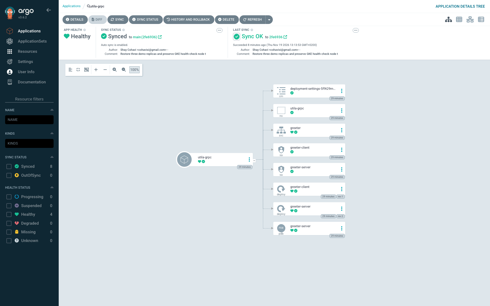
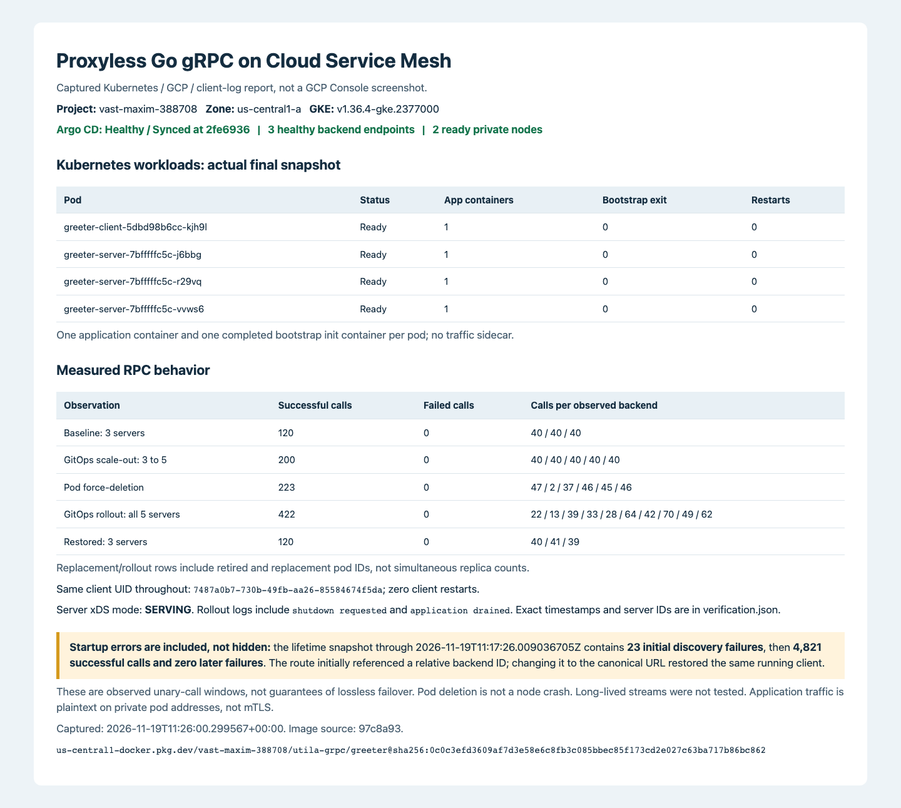

# Live deployment evidence

**Environment:** GCP project `vast-maxim-388708`, GKE cluster `utila-grpc`,
`us-central1-a`. Captured on **2026-11-19**; experiment times below are **UTC**.
This is a real Google-managed Cloud Service Mesh deployment, not the local ADS
test fixture. Snapshots describe the recorded run, not a guarantee about future
live state.

## Reviewer entry points

- [Application source and Part 1 explanations](https://github.com/cohavisi/utila-gRPC)
- [Reproduction, architecture, and teardown runbook](../README.md)
- [Machine-readable verification](evidence/verification.json)
- [Browser-readable captured-data report](evidence/verification.html)
- [Separate manual reproduction report, 2026-11-19](part-2-tasks-3-6-manual-test-report-2026-11-19.md)
  records the later operator-run experiments, their historical qualifications,
  and subsequent CI/backend-cleanup follow-ups.
- [Dated backend-cleanup closure](evidence/manual-20261119T135844Z/backend-cleanup-closure.json):
  a separate read-only observation at `15:10:57Z` found exactly three healthy
  endpoints and no unhealthy entries. The original measurements and screenshots
  below remain unchanged.

The application image was built from
[`97c8a93`](https://github.com/cohavisi/utila-gRPC/commit/97c8a93b730129e1870f824d20b3dbf998a6346e)
and is pinned by digest in the GitOps overlay:

```text
us-central1-docker.pkg.dev/vast-maxim-388708/utila-grpc/greeter@sha256:0c0c3efd3609af7d3e58e6c8fb3c085bbec85f173cd2e027c63ba717b86bc862
```

Later documentation commits do not change the image's source identity.

## Screenshots and final deployment

**Actual authenticated Argo CD UI:** Healthy/Synced at infrastructure revision
[`2fe6936`](https://github.com/cohavisi/utila-gRPC-Infrastructure/commit/2fe6936f934b086f66c566d8af9b45433f9633ac).
The UI shows the application-managed resources; the separate captured-data
report records the individual pods and cloud backend health.



**Captured-data report:** rendered from actual Kubernetes API snapshots,
Compute backend-health output, and structured application logs. This is
explicitly a report screenshot, **not an imitation of the GCP Console**.



The final snapshot contains two Ready private nodes on GKE
`1.36.4-gke.2377000`, three Ready server pods, and one Ready client pod.
Every application pod has exactly one application container and a successfully
completed `xds-bootstrap` init container; there is no traffic-proxy sidecar.
The cloud backend has exactly three `HEALTHY` pod endpoints after scale-down
converged. Server logs show xDS serving mode `SERVING`.

## Measured behavior

The client uses `xds:///greeter.utila.internal:50051`, one reused gRPC channel,
and repeated unary `SayHello` calls. Responses identify the serving pod.
The same client remained running throughout:

```text
Pod:      greeter-client-5dbd98b6cc-kjh9l
UID:      7487a0b7-730b-49fb-aa26-85584674f5da
Restarts: 0
```

| Observation window (UTC) | Result | Failed RPCs |
| --- | --- | --- |
| Baseline, 10:58:22–10:58:52 | 120 successes; 40 on each of 3 servers | 0 |
| Scale-out, 11:01:30–11:02:20 | 200 successes; 40 on each of 5 servers | 0 |
| Pod force-deletion, 11:03:08–11:04:03 | 223 successes; replacement received calls | 0 |
| Server rollout, 11:06:42–11:08:28 | 422 successes while all 5 servers were replaced | 0 |
| Restored baseline, 11:13:55–11:14:25 | 120 successes; 40/41/39 across 3 servers | 0 |

These are selected windows within one continuous client run, not its complete
lifetime. Exact timestamps, server names, and per-backend counts are in the
JSON evidence. Replacement/rollout counts include both retired and replacement
pod IDs, not simultaneous replica totals. Equal distribution is an observation,
not a promise.

Scale-out was committed in
[`93c467e`](https://github.com/cohavisi/utila-gRPC-Infrastructure/commit/93c467e),
the server-only pod-template rollout in
[`d835225`](https://github.com/cohavisi/utila-gRPC-Infrastructure/commit/d835225),
and restoration to three replicas in `2fe6936`. Argo CD reconciled these Git
changes; `kubectl scale` was not used.

The failure experiment force-deleted server pod
`greeter-server-59865496cc-g86gn`; its replacement
`greeter-server-59865496cc-mdgqw` received calls through the unchanged client.
This tests Kubernetes pod replacement, **not a node crash or network partition**.

An old server emitted the following during the controlled rollout:

```json
{"time":"2026-11-19T11:07:26.306238006Z","level":"INFO","msg":"shutdown requested"}
{"time":"2026-11-19T11:07:26.309387857Z","level":"INFO","msg":"application drained"}
```

This supports graceful termination during the observed unary workload. It does
not test long-lived streams, forced-drain deadlines, or guarantee lossless
failover.

## Startup failures and live findings

**Startup was not error-free.** The client lifetime snapshot from
`10:53:19Z` through `11:17:26Z` contains **23 initial discovery failures**.
The first successful call was at `10:57:11.961170061Z`; the snapshot contains
**4,821 successes and zero failures after that first success**. Later running
time is outside this fixed lifetime snapshot.

Two live findings were corrected rather than hidden:

1. **Canonical backend reference.** The initial `GRPCRoute` used the backend's
   relative Terraform `.id`. Google accepted the resource and servers/backend
   health were green, but the client had no usable Listener. Switching to
   `.self_link`, the canonical Compute backend URL, restored the original
   client without a restart. Fix:
   [`fc4d032`](https://github.com/cohavisi/utila-gRPC-Infrastructure/commit/fc4d032).
   This is why resource validity, Argo health, or a ready server alone did not
   prove end-to-end xDS operation.
2. **Preserving health-check node tags.** After bootstrap-pool removal, GKE
   reported the remaining workload pool through the cluster's `node_config`.
   Aligning its tags with the separate workload pool prevented a later plan
   from stripping the health-check firewall target tag. The corrected platform
   and routing plans both reported **No changes**; no node replacement was
   needed.

## Scope and ownership

Terraform owns the cloud network, GKE, identities, mesh, endpoint policy,
backend, health check, and route. Argo CD owns application Kubernetes resources.
GKE's NEG controller owns pod membership; Argo CD does not execute Terraform.

Application gRPC is intentionally **plaintext on private pod addresses**.
Google control-plane access is authenticated/encrypted; this is **not
application mTLS** or a production-security claim. There is no public
application load balancer. This single-zone environment is a demonstration,
not a high-availability deployment.

The local xDS integration test independently verifies refusal before server
Listener configuration; this failure mode was not injected into the live mesh.
The runtime evidence does not establish behavior under every failure or load.

**The GCP resources remain running and billable.** After review, use the
runbook's ordered teardown: stop Argo reconciliation, destroy routing, remove
the Service/workloads and verify NEG cleanup, then destroy the platform.
Retain the protected state bucket and securely backed-up bootstrap state unless
explicitly retiring them.
