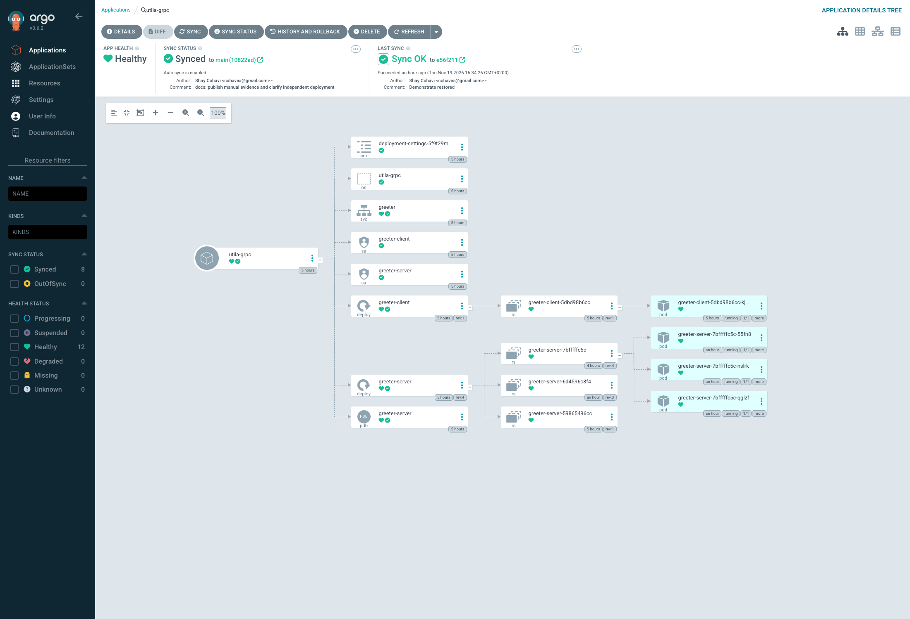
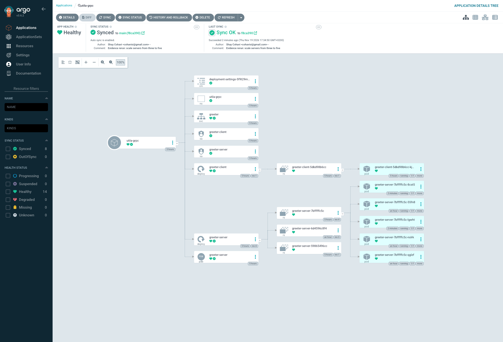
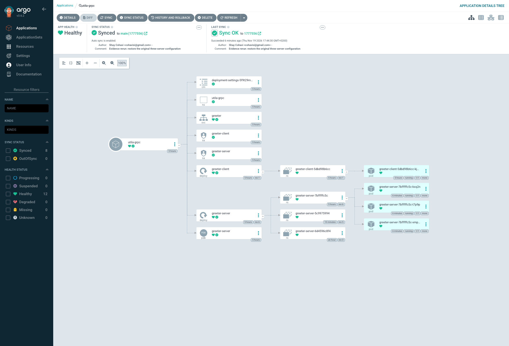
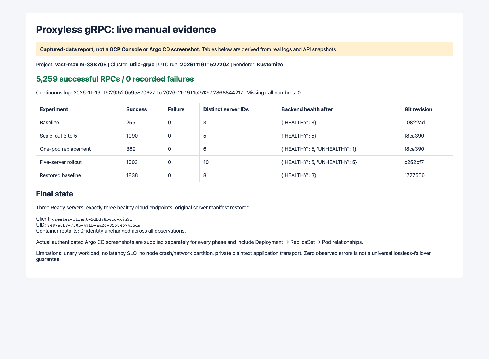

# Part 2, Tasks 3-6: Live Evidence Rerun, 20261119T152720Z

This is a new, real GKE/Cloud Service Mesh experiment, run at the user's direction
with Copilot executing the commands and collecting evidence. It is not an
independently executed human test. All timestamps are UTC. The existing
Kustomize deployment was used; no Helm or Terraform changes were made.

## Result

The continuous client log contains **5,259 successful
RPCs and 0 recorded failures**, from
`2026-11-19T15:29:52.059587092Z` through `2026-11-19T15:51:57.286884421Z`.
There are **0 missing call numbers**
and **0 duplicate call numbers** within that
captured range. Per-phase segments below are selected from this same continuous
stream; do not add their counts to the continuous total.

The original client UID remained `7487a0b7-730b-49fb-aa26-85584674f5da`, with
`0` application-container restarts. The final state
has three Ready servers and exactly three healthy backend endpoints, without
retired unhealthy entries. The original server manifest was restored
byte-for-byte in Git.

All captured workloads used the same immutable application image:

```text
us-central1-docker.pkg.dev/vast-maxim-388708/utila-grpc/greeter@sha256:0c0c3efd3609af7d3e58e6c8fb3c085bbec85f173cd2e027c63ba717b86bc862
```

The bootstrap init image was also unchanged and digest-pinned; its exact
reference is recorded in the verification JSON.

## Experiment measurements

| Experiment | Success | Failure | Distinct server IDs | Backend health after | Git revision |
| --- | --- | --- | --- | --- | --- |
| Baseline | 255 | 0 | 3 | {'HEALTHY': 3} | [`10822ad`](https://github.com/cohavisi/utila-gRPC-Infrastructure/commit/10822adbd925ab0f23594529055caee847dc5237) |
| Scale-out 3 to 5 | 1090 | 0 | 5 | {'HEALTHY': 5} | [`f8ca390`](https://github.com/cohavisi/utila-gRPC-Infrastructure/commit/f8ca390a46f2413c4672b52c898748ccbe89415b) |
| One-pod replacement | 389 | 0 | 6 | {'HEALTHY': 5, 'UNHEALTHY': 1} | [`f8ca390`](https://github.com/cohavisi/utila-gRPC-Infrastructure/commit/f8ca390a46f2413c4672b52c898748ccbe89415b) |
| Five-server rollout | 1003 | 0 | 10 | {'HEALTHY': 5, 'UNHEALTHY': 5} | [`c252bf7`](https://github.com/cohavisi/utila-gRPC-Infrastructure/commit/c252bf7d30a280f1ce6b9ce6c9466a00fa7081f8) |
| Restored baseline | 1838 | 0 | 8 | {'HEALTHY': 3} | [`1777556`](https://github.com/cohavisi/utila-gRPC-Infrastructure/commit/17775569990d0f369b7bb33f6f57863c7966a44b) |

Server IDs count all backends used during a window, including retired and
replacement pods, rather than simultaneous replicas. All phase Application
snapshots are Healthy/Synced. The Pod deletion was graceful; it is not a node
crash or forced-kill test. The server-only rollout and restoration are distinct
pod-template changes, while the client remained running.

## Server-side xDS, draining, and CI

The fresh [startup logs](evidence/manual-20261119T152720Z/rollout-server-startup.log)
record **5 rollout servers entering xDS SERVING**. The separately
followed [old-server logs](evidence/manual-20261119T152720Z/rollout-server-drain.log)
record **5 old servers completing application draining**.
These observations apply to this unary workload, not arbitrary streaming RPCs.
The Service UID was unchanged between baseline and restoration.
Per-revision CI outcomes and URLs are recorded in the verification JSON.

## Actual dashboard screenshots

These are real authenticated Argo CD UI captures. Its resource-tree API was
also captured and checked for four visible Pods at baseline/restoration and
six visible Pods during the five-server phases. Screenshot timestamps and
resource identities are in the verification JSON.

### Baseline



### Scale-out 3 to 5



### One-pod replacement


### Five-server rollout


### Restored baseline



## Captured-data summary

The image below renders the measured data; it is explicitly **not** a GCP
Console screenshot or a replacement for the authentic Argo CD images above.



## Audit artifacts

- [Machine-readable measurements and source hashes](evidence/manual-20261119T152720Z/verification.json)
- [Continuous raw client log](evidence/manual-20261119T152720Z/client-continuous.jsonl)
- [Browser-readable captured-data report](evidence/manual-20261119T152720Z/verification.html)

Detailed Kubernetes, backend-health, Application, and timing captures remain
in `.tmp/evidence-20261119T152720Z/`. Their hashes are recorded in the verification
JSON; the full raw snapshots are not republished. The public summary omits
private Pod IPs and authentication material. Earlier evidence packages remain
unchanged and describe their own observation windows.

## Scope and limitations

The measurements demonstrate this unary workload's balancing, Git-controlled
scale-out, pod replacement, and server rolling updates through the original
client. `WaitForReady` can absorb transient unavailability within the configured
10-second deadline; zero failed calls does not establish zero latency impact.
No long-lived-stream, node-loss, network-partition, or application-mTLS claim is
made. Application transport remains plaintext on private Pod addresses.

The screenshot-only local connection and client log collector were temporary.
Cloud resources remain running and billable; normal application traffic
continues after the test.
